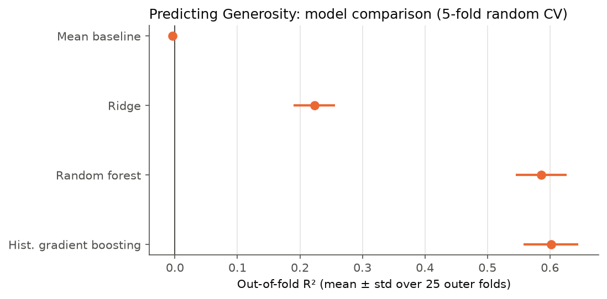
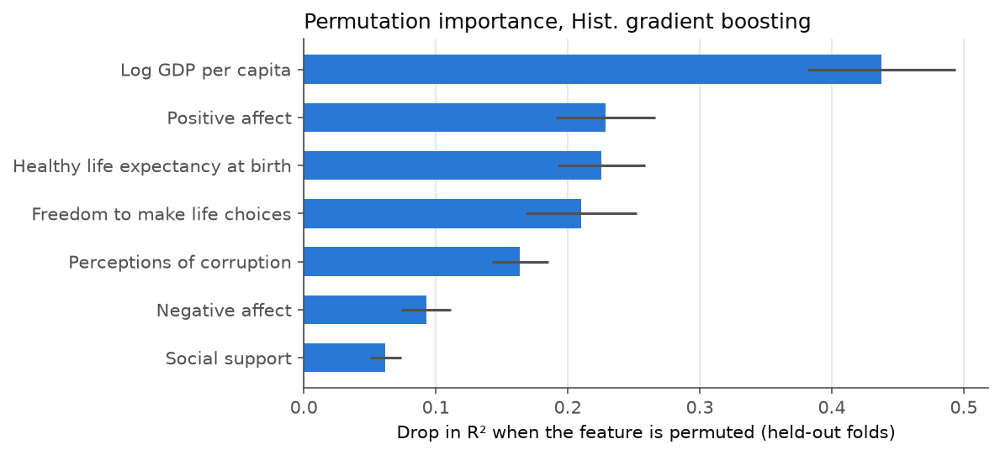
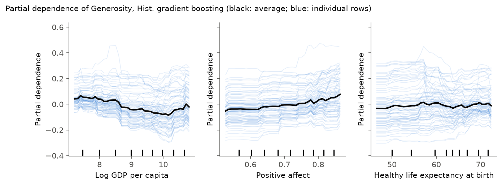

# Predicting Generosity from the World Happiness Report 2018

A small, reproducible study of how well a country-year's *Generosity* score can
be predicted from other World Happiness Report indicators, using scikit-learn
pipelines, nested cross-validation and held-out model interpretation.

## Question

Given seven national indicators for a country-year (log GDP per capita, social
support, healthy life expectancy, freedom to make life choices, perceptions of
corruption, positive affect and negative affect), how much of the variation in
*Generosity* can be predicted?

*Generosity* in the WHR is the residual of regressing the national average
response to the Gallup World Poll question "Have you donated money to a charity
in the past month?" on GDP per capita. It is therefore already adjusted for
income.

## Data

- Source: World Happiness Report 2018, Chapter 2 online data
  (`data/WHR2018Chapter2OnlineData.csv`, 1,562 country-year rows, 19 columns,
  164 countries, 2005-2017). 1,482 rows from 160 countries have a Generosity
  value and are used.
- Citation: Helliwell, J. F., Layard, R., & Sachs, J. D. (2018).
  *World Happiness Report 2018*. New York: Sustainable Development Solutions
  Network. https://worldhappiness.report/ed/2018/
- The underlying survey data are from the Gallup World Poll. The CSV is kept in
  the repository unchanged, as in the original version of this project.

## Method

- **Pipelines.** Every model is a scikit-learn `Pipeline`. Ridge and random
  forest impute missing features with the median (and Ridge standardises) inside
  the pipeline, so these statistics are computed on training folds only.
  Histogram gradient boosting uses its native missing-value handling.
- **Models.** Mean-prediction baseline (an R² floor of about zero), Ridge
  regression, random forest, and `HistGradientBoostingRegressor`.
- **Original protocol.** The original notebook's evaluation, one random 75/25
  split of rows (`random_state=11`) with linear regression and a default random
  forest, is reproduced exactly by `reproduce_original` in
  [`src/whr_generosity/evaluate.py`](src/whr_generosity/evaluate.py).
- **Cross-validation.** Repeated nested cross-validation over rows. The outer
  loop is shuffled 5-fold CV, repeated 5 times with different seeds (25 outer
  folds), and estimates performance; the inner loop is 5-fold CV on the outer
  training data and selects hyperparameters by grid search.
- **Interpretation.** Permutation importance is computed for each outer fold's
  model on that fold's held-out rows (rather than impurity importance, which is
  measured on training data). Partial dependence, with a sample of individual
  (ICE) curves, is plotted for the top three features of the best model refitted
  on all data.
- **Options.** `--grouping country` additionally runs the same procedure with
  folds grouped by country (each country's rows kept within one fold).
- Everything is seeded (`--seed`, default 0); running the CLI twice produces a
  byte-identical `results/metrics.json` and identical figures.

## Results

Generated by `python -m whr_generosity`; full output in
[`results/metrics.md`](results/metrics.md) and
[`results/metrics.json`](results/metrics.json).

Original protocol, reproduced:

| Model (random 75/25 split) | R² | MSE |
|---|---|---|
| Linear regression | 0.268 | 0.0189 |
| Random forest (defaults) | 0.610 | 0.0101 |

Nested 5-fold random CV, mean ± sample standard deviation over 25 outer folds
(5 folds x 5 repeats):

| Model (5-fold random CV) | R² | MSE | MAE |
|---|---|---|---|
| Mean baseline | -0.004 ± 0.005 | 0.0270 ± 0.0022 | 0.1288 ± 0.0046 |
| Ridge | 0.223 ± 0.033 | 0.0209 ± 0.0017 | 0.1143 ± 0.0044 |
| Random forest | 0.586 ± 0.041 | 0.0111 ± 0.0013 | 0.0787 ± 0.0045 |
| Hist. gradient boosting | 0.602 ± 0.044 | 0.0107 ± 0.0014 | 0.0771 ± 0.0048 |



The linear regression result matches the original notebook to all printed
digits (R² 0.268). The random forest gives 0.610 with today's scikit-learn,
against 0.613 in the original (tree-building internals changed between
versions). Under cross-validation the two tree ensembles perform similarly
(R² around 0.6), well above Ridge and the mean baseline.

Permutation importance for the best cross-validated model (histogram gradient
boosting), on held-out folds:

| Feature | Drop in R² when permuted (mean ± std over folds) |
|---|---|
| Log GDP per capita | 0.438 ± 0.056 |
| Positive affect | 0.229 ± 0.038 |
| Healthy life expectancy at birth | 0.225 ± 0.033 |
| Freedom to make life choices | 0.210 ± 0.042 |
| Perceptions of corruption | 0.164 ± 0.021 |
| Negative affect | 0.093 ± 0.019 |
| Social support | 0.062 ± 0.012 |




## Changes in this version

- A Python package (`src/whr_generosity/`) with a command-line entry point
  replaces the single notebook; all results and figures are regenerated from
  scratch with one command.
- Preprocessing (imputation, scaling) now happens inside scikit-learn pipelines
  fitted on training folds, and hyperparameters are tuned by nested CV.
- Ridge regression and histogram gradient boosting are added alongside the
  random forest, with a mean baseline as a floor for R².
- Permutation importance on held-out folds and partial-dependence plots
  replace impurity-based feature importances.
- Tests (`pytest`) and GitHub Actions CI were added.
- The notebook (`notebooks/generosity_study.ipynb`) is now a short narrative
  over the package; the original notebook is in the git history
  (`RandomRegressor.ipynb` at commit `7fff581`). The 0.613 in the old README
  came from the default random forest, not the grid-searched one (which scored
  0.610 in the original notebook).

## Reproduce

```bash
python3.12 -m venv .venv && source .venv/bin/activate
pip install -e ".[dev]"
python -m whr_generosity   # writes results/ and figures/ (about 8 minutes on a laptop)
```

`pytest -q` runs the test suite (under 30 seconds). `python -m whr_generosity
--quick` is a fast smoke run with small grids; its numbers are not for
reporting. The notebook is executed with
`jupyter nbconvert --to notebook --execute notebooks/generosity_study.ipynb`.

## Project layout

```
data/                     WHR 2018 Chapter 2 CSV (unchanged)
src/whr_generosity/       data loading, features, models, evaluation, plots, CLI
tests/                    pytest suite (data, splits, pipeline, CLI)
results/                  metrics.json and metrics.md (generated)
figures/                  PNG figures (generated)
notebooks/                narrative notebook that imports the package
.github/workflows/ci.yml  lint, tests, smoke reproduction, notebook execution
```

## Limitations

- **Evaluation scope.** Rows are country-years and both protocols split rows at
  random; `--grouping country` runs the same procedure with folds grouped by
  country.
- **Fold-to-fold variation.** The standard deviation across folds is a rough
  guide to variability, not a confidence interval (folds share training data).
- **Model selection.** The "best model" is chosen by the same outer-CV scores
  that are reported, which is slightly optimistic; the random forest and
  gradient boosting are close.
- **Associations only.** Importances and partial dependence describe the
  fitted model, not causal effects. Several features are correlated (for
  example GDP and life expectancy), which makes both permutation importance and
  partial dependence harder to interpret for any single feature.
- **Fixed feature set and data vintage.** The seven features follow the
  original analysis; country-year panel structure (lags, trends) is not used.
  Newer WHR releases were not added; later releases rename and redefine some
  columns, so adding them would need an explicit, checked column mapping.

## License

MIT, see [LICENSE](LICENSE). The data are the World Happiness Report's; cite
the report when using them.
